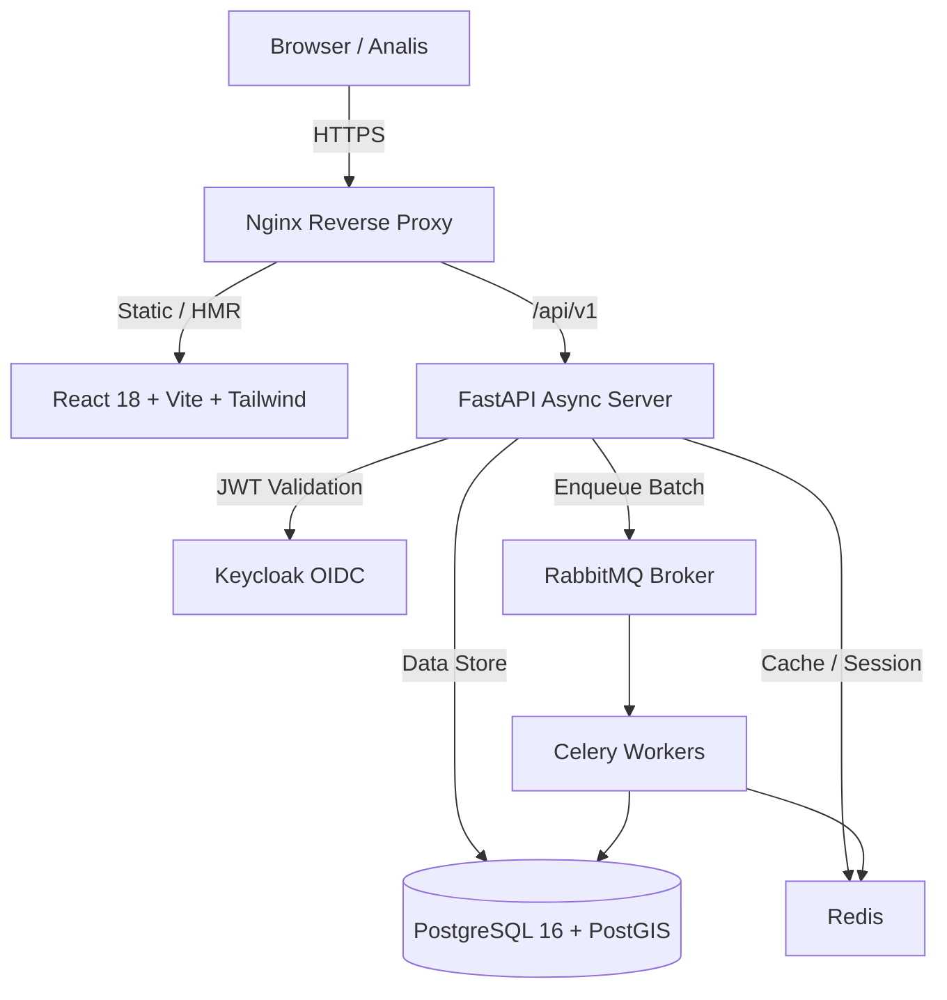

# ARCHITECTURE.md — Rekonsiliasi Data Pelanggan

## 1. Ikhtisar Sistem
Aplikasi **Rekonsiliasi Data Pelanggan** dirancang untuk memproses, membersihkan, dan mencocokkan data pelanggan listrik (pascabayar, prabayar, PDPJ, dan koordinat kosong) secara spasial menggunakan PostGIS geography.

## 2. Arsitektur Komponen

## 3. Komponen Utama
- **Frontend SPA**: React 18, TypeScript, Tailwind CSS, TanStack Table (server-side pagination), TanStack Query, MapProvider (Mapbox GL / Google Maps).
- **Backend API**: FastAPI (Python 3.12), SQLAlchemy 2.0 (async), Pydantic v2, Alembic.
- **Worker & Queue**: Celery 5.x dengan RabbitMQ message broker dan Redis result backend.
- **Geospasial**: PostgreSQL 16 + PostGIS 3.4 (`geography(Point, 4326)` dengan GiST index).
- **Autentikasi & RBAC**: OpenID Connect (OAuth2) via Keycloak dengan 3 role: Analis, Admin, Auditor.
- **Audit Logging**: Mencatat setiap aksi tulis (user, entity, timestamp, IP, before/after snapshot dengan IDPEL masked).

## 4. Keamanan & Proteksi IDPEL
- **At-rest Encryption**: IDPEL disimpan terenkripsi menggunakan AES-256-GCM (`idpel_encrypted`).
- **Blind Index**: HMAC-SHA256 dari IDPEL (`idpel_blind_index`) untuk pencarian, join, deduplikasi, dan left anti-join tanpa perlu mendekripsi seluruh database.
- **Log Masking**: IDPEL tidak pernah dicatat dalam log mentah.
