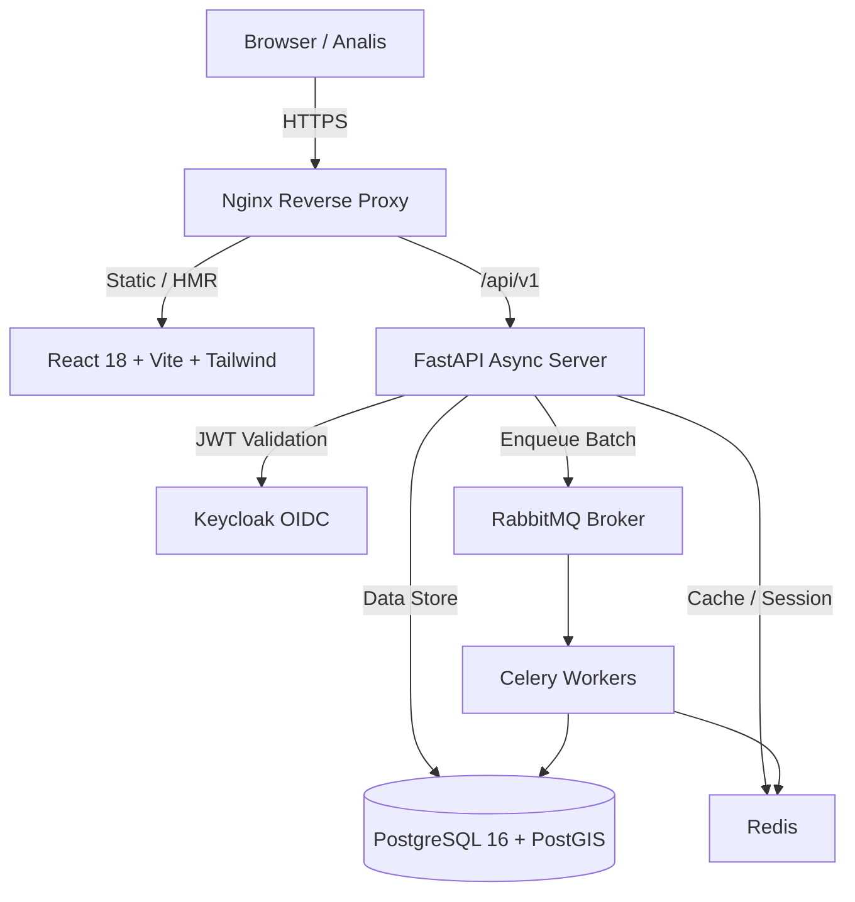

# ARCHITECTURE.md — Rekonsiliasi Data Pelanggan & Spasial

## 1. Ikhtisar Sistem
Aplikasi **Rekonsiliasi Data Pelanggan & Spasial** dirancang untuk memproses, membersihkan, dan mencocokkan data pelanggan listrik (Master, PDPJ, Koordinat Kosong) secara spasial menggunakan PostGIS geography dan alur rekonsiliasi anti-join.

## 2. Arsitektur Komponen

## 3. Komponen Utama
- **Frontend SPA**: React 18 + TS + Vite, TanStack Query/Table, MapProvider (Mapbox/Google).
  - Mendukung **Web Filter Kolom Otomatis** dinamis berdasarkan tipe upload.
- **Backend API**: FastAPI, SQLAlchemy, Pydantic, Alembic.
- **Geospasial**: PostgreSQL 16 + PostGIS (`geography(Point, 4326)`, GiST index).

## 4. Keamanan & Proteksi IDPEL
- **At-rest Encryption**: AES-256-GCM (`idpel_encrypted`).
- **Blind Index**: HMAC-SHA256 (`idpel_blind_index`) untuk dedup/anti-join.
- **Log Masking**: IDPEL tidak pernah dicatat plaintext di Audit Log.
