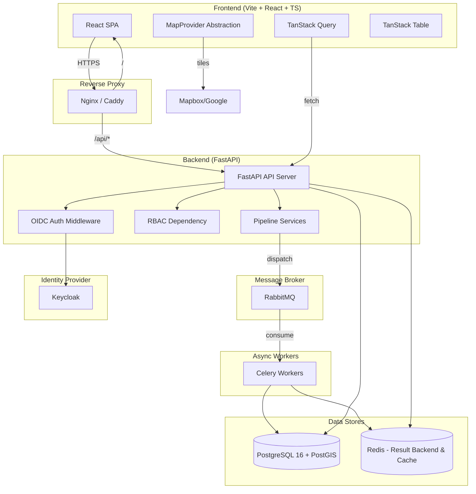
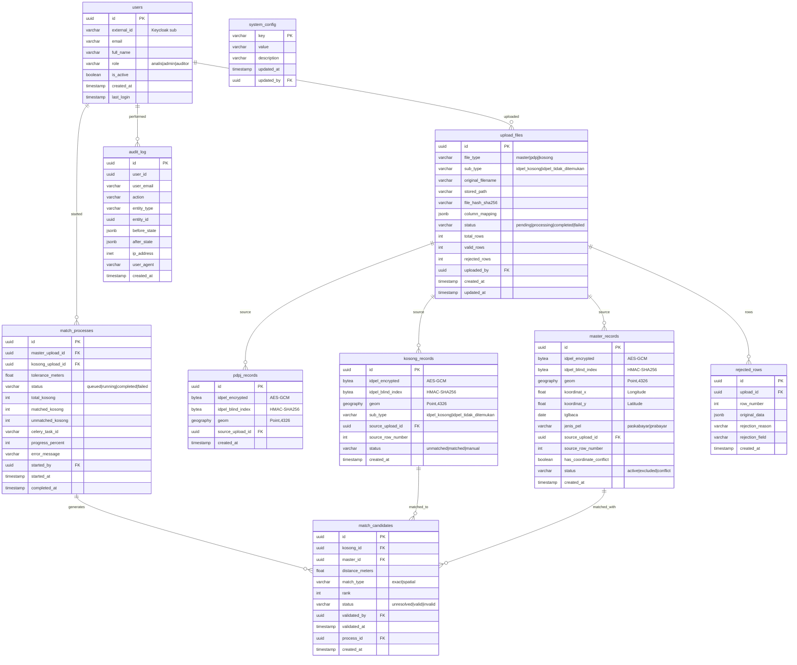

# Implementation Plan — Rekonsiliasi Data Pelanggan & Spasial PLN

> **Status**: Approved & Finalized  
> **Tanggal**: 2026-10-16  
> **Peran**: Senior Software Architect & Technical Writer  

---

## 1. Arsitektur Tingkat Tinggi



### Komponen Utama

| Komponen | Teknologi | Port (dev) |
|---|---|---|
| Frontend | React 18 + TS + Vite | 5173 |
| API Server | FastAPI (uvicorn) | 8000 |
| Celery Worker | Celery 5.x | — |
| PostgreSQL | 16 + PostGIS 3.4 | 5432 |
| RabbitMQ | 3.13 | 5672 / 15672 |
| Redis | 7.x | 6379 |
| Keycloak | 24.x | 8080 |
| Nginx (dev proxy) | latest | 80 |

---

## 2. Skema Database (ERD)



---

## 3. Integrasi Logika Bisnis & Alur Upload

### 3.1 Spesifikasi Input & Kolom per Jenis File
1. **Master (Gabungan Paskabayar & Prabayar)**:
   - Kolom yang dipakai: `idpel`, `koordinat_x`, `koordinat_y`, `tglbaca`, `jenis_pel`.
   - `koordinat_x` = Longitude (X), `koordinat_y` = Latitude (Y).
   - Membentuk geometri WGS84 (`Point(koordinat_x koordinat_y)`).

2. **PDPJ**:
   - Kolom yang dipakai: `idpel`, `koordinat` (opsional).
   - Fungsi utama: Anti-join berdasarkan `idpel` untuk mengecualikan data PDPJ dari Master dan proses pencocokan.

3. **Koordinat Kosong**:
   - Subtipe `idpel_kosong`: Kolom yang dipakai hanya `koordinat` (IDPEL kosong).
   - Subtipe `idpel_tidak_ditemukan`: Kolom yang dipakai `idpel` dan `koordinat` (IDPEL ada di file tetapi tidak ditemukan di Master).

### 3.2 Web Filter Kolom Otomatis & UI Mapping
- **Langkah 1**: User memilih tipe upload terlebih dahulu (**Master** / **PDPJ** / **Koordinat Kosong**).
- **Langkah 2**: Jika memilih **Koordinat Kosong**, user wajib memilih subtipe: `IDPEL Kosong` atau `IDPEL Tidak Ditemukan`.
- **Langkah 3**: Frontend menampilkan kolom input/mapping yang relevan secara dinamis sesuai tipe/subtipe yang dipilih. Kolom di luar kebutuhan akan diabaikan.
- **Langkah 4**: Sistem melakukan **Auto-Detect Mapping** berdasarkan header file (pattern matching nama kolom). Analis dapat melakukan koreksi manual sebelum file diproses lebih lanjut.

### 3.3 Pipeline Flow

```mermaid
flowchart TD
    A[Pilih Tipe & Subtipe Upload] --> B[Upload File & Validasi]
    B --> C[Simpan File + Hitung SHA-256]
    C --> D{Duplikat?}
    D -->|Ya| E[Peringatan Duplikasi]
    D -->|Tidak| F[Web Filter Kolom & Auto-detect Mapping]
    F --> G[Koreksi Manual Mapping oleh User]
    G --> H[Dispatch Celery Task]
    
    H --> I[Cleaning Pipeline]
    I --> I1[IDPEL Cleaner: Trim, Non-digit, Panjang]
    I --> I2[Koordinat / Long-Lat Cleaner]
    I2 --> I2a[Parse koordinat_x/y atau string koordinat 'lat,lon']
    I2b --> I2c[Validasi Range Wilayah Indonesia]
    I2d --> I2e[Buang 0,0 / Invalid -> rejected_rows]
    
    I --> J[Enkripsi AES-GCM + Blind Index HMAC-SHA256]
    J --> K[Bulk Insert via COPY]
    K --> L[Deduplikasi Exact Blind Index]
    L --> M{Konflik Koordinat?}
    M -->|Ya| N[Flag has_coordinate_conflict = true]
    M -->|Tidak| O[Data Siap Digunakan]
    
    O --> P[Exclude PDPJ - Anti-join on blind_index]
    P --> Q[Spatial Matching (Exact & DWithin)]
    Q --> R[Insert match_candidates]
    R --> S[Candidate List UI & Export CSV]
```

### 3.4 Spatial Matching Query (SQL)

```sql
-- Exact match
SELECT k.id AS kosong_id, m.id AS master_id, 0.0 AS distance_meters, 'exact' AS match_type
FROM kosong_records k
JOIN master_records m ON ST_Equals(k.geom::geometry, m.geom::geometry)
WHERE k.source_upload_id = :upload_id AND m.status = 'active';

-- Spatial proximity (ST_DWithin + KNN ranking)
SELECT k.id AS kosong_id, m.id AS master_id,
       ST_Distance(k.geom, m.geom) AS distance_meters,
       'spatial' AS match_type,
       ROW_NUMBER() OVER (PARTITION BY k.id ORDER BY k.geom::geometry <-> m.geom::geometry) AS rank
FROM kosong_records k
JOIN LATERAL (
    SELECT m2.id, m2.geom
    FROM master_records m2
    WHERE m2.status = 'active'
      AND ST_DWithin(m2.geom, k.geom, :tolerance_meters)
    ORDER BY m2.geom::geometry <-> k.geom::geometry
    LIMIT 10
) m ON true
WHERE k.source_upload_id = :upload_id;
```

---

## 4. Desain Enkripsi IDPEL + Blind Index

### Prinsip Keamanan & Kinerja
- **`idpel_encrypted` (AES-256-GCM)**: Untuk kerahasiaan data at-rest yang dapat didekripsi on-demand untuk keperluan display.
- **`idpel_blind_index` (HMAC-SHA256)**: Blind index deterministik untuk operasi database efisien (deduplikasi, anti-join PDPJ, pencarian) tanpa dekripsi massal.
- **Audit Log**: IDPEL tidak pernah dicatat dalam plaintext (`before_state`/`after_state`), melainkan menggunakan blind_index atau masking (`***789012`).

---

## 5. RBAC & Spesifikasi Output Export CSV

### 5.1 RBAC Matrix
| Endpoint | Analis | Admin | Auditor |
|---|:---:|:---:|:---:|
| POST /upload/* | ✅ | ✅ | ❌ |
| POST /process/match | ✅ | ✅ | ❌ |
| GET /candidates | ✅ | ✅ | ❌ |
| PATCH /candidates/{id} | ✅ | ✅ | ❌ |
| POST /manual-entry | ✅ | ✅ | ❌ |
| GET /history | ✅ | ✅ | ✅ |
| GET /export/{id} | ✅ | ✅ | ❌ |
| GET /audit-log | ❌ | ✅ | ✅ |
| PUT /config/* | ❌ | ✅ | ❌ |
| GET /health | 🔓 | 🔓 | 🔓 |

### 5.2 Spesifikasi Format Export CSV
Hasil unduhan CSV rekonsiliasi wajib mengikuti struktur header exact berikut:
```csv
noagenda,idpelanggan,verif,jenispelanggan,latitudey,longitudex
```
- **`noagenda`**: Nomor agenda atau identifier proses (atau kosong jika pencocokan murni).
- **`idpelanggan`**: ID Pelanggan hasil rekonsiliasi.
- **`verif`**: Status verifikasi (`1` untuk valid/approved, `0` untuk unverified/rejected).
- **`jenispelanggan`**: Jenis pelanggan dari Master (`paskabayar` / `prabayar`).
- **`latitudey`**: Nilai koordinat Latitude (Y).
- **`longitudex`**: Nilai koordinat Longitude (X).

---

## 6. MapProvider Abstraction

```typescript
// lib/map/MapProvider.ts
interface MapProvider {
  init(container: HTMLElement, options: MapOptions): Promise<MapInstance>;
  addMarker(position: LatLng, options?: MarkerOptions): Marker;
  addLine(from: LatLng, to: LatLng, options?: LineOptions): Line;
  addCluster(markers: Marker[]): Cluster;
  fitBounds(bounds: LatLngBounds): void;
  destroy(): void;
}
```

---

## 7. Struktur Repositori

```
/backend
  /app
    /api/v1          # endpoints (upload, candidates, process, export)
    /core            # config, security, encryption
    /models          # SQLAlchemy ORM models
    /schemas         # Pydantic v2 schemas
    /services        # Business logic & pipeline
    /tasks           # Celery background tasks
    main.py
  /alembic
  /tests
  requirements.txt

/frontend
  /src
    /features        # upload (dynamic sub-type & column filter), candidates, monitoring, audit, auth
    /components      # Shared UI components
    /api             # TanStack Query hooks
    /lib/map         # MapProvider abstraction
    App.tsx
    main.tsx
  vite.config.ts

/docs                # ARCHITECTURE.md, API.md, DATA_RULES.md, RUNBOOK.md
/infra               # docker-compose.yml, keycloak, nginx
/scripts             # generate_synthetic_data.py, seed_db.py
.env.example
Makefile
README.md
```

---

## 8. Risiko & Mitigasi

| Risiko | Dampak | Mitigasi |
|---|---|---|
| File besar (>500k baris) OOM | Gagal proses upload | Chunked processing 10k baris, streaming parser |
| Ketidakcocokan format header CSV/XLSX | Error mapping kolom | Web filter otomatis + auto-detect header + koreksi manual di UI |
| Spatial query lambat | Timeout proses | GiST index + LATERAL KNN optimization |
